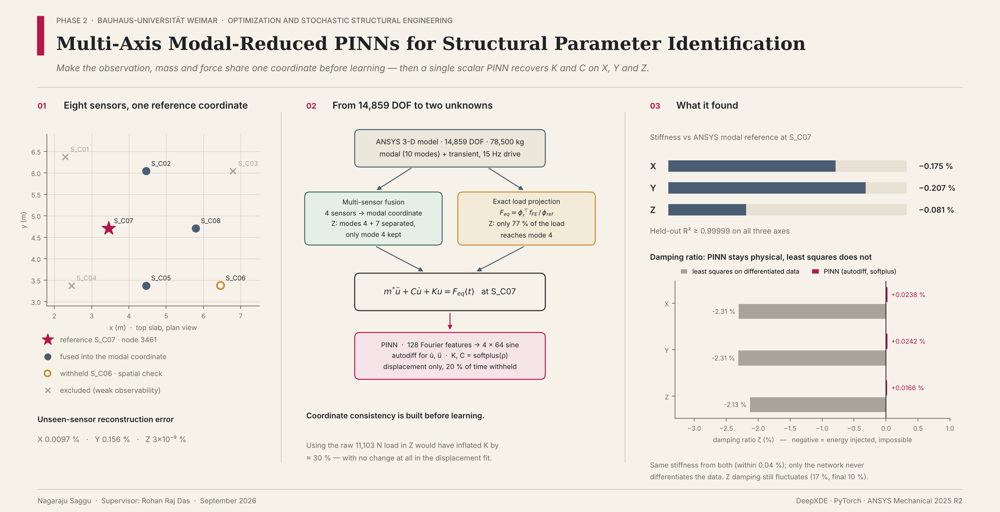

<p align="center">
  
</p>

<h1 align="center">Multi-Axis Modal-Reduced Physics-Informed Neural Networks for Structural Parameter Identification</h1>

<p align="center">
  <em>A generalised-force projection and multi-sensor reference-coordinate framework for stiffness and damping recovery in a three-dimensional MDOF structure</em>
</p>

<p align="center">
  
  
  
  
  
</p>

<p align="center">
  <b>Nagaraju Saggu</b> · Supervisor: Rohan Raj Das<br>
  Chair of Optimization and Stochastic Structural Engineering · Bauhaus-Universität Weimar · September 2026
</p>

---

## Contents

1. [In one paragraph](#in-one-paragraph)
2. [What changed from Phase 1](#what-changed-from-phase-1)
3. [The problem: coordinate consistency](#the-problem-coordinate-consistency)
4. [The structure and the data](#the-structure-and-the-data)
5. [The reduction chain](#the-reduction-chain)
6. [The network](#the-network)
7. [Results](#results)
8. [PINN vs least squares: the honest comparison](#pinn-vs-least-squares-the-honest-comparison)
9. [Repository structure](#repository-structure)
10. [Running the pipeline](#running-the-pipeline)
11. [Limitations](#limitations)
12. [Future work](#future-work)
13. [References](#references)

---

## In one paragraph

A steel support table (five bodies, 828 SOLID186 elements, **14,859 degrees of freedom**, 78,500 kg) is driven at 15 Hz in ANSYS Mechanical 2025 R2. Eight sensors on the top slab record its motion. Before any learning happens, the problem is made **coordinate-consistent**:
- Four sensors are fused into one modal coordinate.
- Everything is referred to a single reference node, S_C07 (node 3461).
- The applied load is projected onto the retained mode through the actual finite element load vector.
- A fifth sensor, S_C06, is held back as an unseen spatial check.

What reaches the network is a scalar equation, $m^\ast\ddot u + C\dot u + Ku = F_{eq}(t)$, with two unknowns. A Fourier-feature PINN trained on displacement alone recovers stiffness within **0.08–0.21 %** of the ANSYS modal reference on all three axes. It also returns **positive, physically admissible damping** where classical least squares returns impossible negative values.

---

## What changed from Phase 1

| | Phase 1 | Phase 2 |
|---|---|---|
| Observation | One node (3575), raw displacement | 8 slab sensors; 4 fused into one modal coordinate at S_C07 |
| Effective mass | From one node; Z mass 73× the whole table | $m^\ast = \phi_{\text{ref}}^{-2}$ at one common reference node for all axes |
| Force | Configured amplitude (Z was not derived) | Exact FE load-vector projection $F_{eq} = \phi_r^{\top} f_{FE} / \phi_{\text{ref}}$ |
| Vertical (Z) response | Treated as single-mode | Two-mode spatial decomposition (modes 4 + 7), only mode 4 learned |
| Spatial validation | None | Withheld sensor S_C06 |
| Stiffness vs modal reference | −9.5 % / −9.1 % / +0.014 % | **−0.175 % / −0.207 % / −0.081 %** |
| Z damping | Not observable (T/τ ≈ 0.002) | Recovered, positive (T/τ ≈ 0.54), though not tightly converged |

---

## The problem: coordinate consistency

A single-degree-of-freedom identification claims that some scalar observation $u(t)$ obeys

$$
m^\ast\ddot u(t) + C\dot u(t) + K u(t) = F(t).
$$

Four conditions are hidden in that claim. Each can fail on its own, whatever estimator is used.

| Requirement | What goes wrong if ignored | How Phase 2 meets it |
|---|---|---|
| **Observation**: $u$ is the response of one mode | K becomes a weighted average of several modes, belonging to none | Multi-sensor modal fusion; two-mode separation in Z |
| **Mass**: $m^\ast$ is the generalised mass at that coordinate | Mass changes by orders of magnitude between nodes | One reference node S_C07 for all axes, $m^\ast = \phi_{\text{ref}}^{-2}$ |
| **Force**: $F$ is the modal share of the load, not the resultant | K is inflated by the misalignment factor; the fit looks just as good | Exact projection of the FE load vector onto the mode |
| **Spatial support**: there must be a way to detect 1–3 failing | A node near a nodal line silently switches the mode being identified | Withheld sensor S_C06 |

The force row matters most. In Z only **76.85 %** of the applied resultant participates in mode 4. Using the raw 11,103 N load would have inflated the vertical stiffness by **+30 %**, and the displacement fit would have been no worse — the error is invisible in every fit statistic.

---

## The structure and the data

### Finite element source

| | |
|---|---|
| Solver | ANSYS Mechanical 2025 R2 |
| Mesh | 5 bodies · 828 SOLID186 elements · 14,859 DOF |
| Mass | 78,500 kg |
| Modal analysis | Block Lanczos, 10 modes, mass-normalised ($\phi_r^{\top} M \phi_r = 1$) |
| Transient analysis | 0.001–10 s at Δt = 1 ms, 15 Hz harmonic, 11,103 N over a 20 m² face (555.15 Pa peak) |
| Damping in source | Zero physical damping; 0.005 numerical damping in time integration |

### Retained modes

| Axis | Mode | $f_r$ (Hz) | Character | Effective modal mass |
|---|---|---|---|---|
| X | 1 | 20.0835 | dominant X bending | 86.8 % |
| Y | 2 | 20.6581 | dominant Y bending | 87.2 % |
| Z | 4 | 51.4342 | principal Z slab | 57.3 % |
| Z (removed) | 7 | 114.1081 | secondary Z contribution | 3.0 % |

### Sensors (all on the top slab, z = 0.35 m)

| Sensor | Node | Role |
|---|---|---|
| **S_C07** | 3461 | **Reference coordinate** + fusion |
| S_C02, S_C05, S_C08 | 3514, 3402, 3454 | Fusion |
| S_C06 | 3396 | **Withheld** — spatial validation only |
| S_C01, S_C03, S_C04 | 5003, 3507, 3408 | Excluded. Their vertical observability score was an order of magnitude below the retained sensors, so they would worsen the conditioning without adding information. |

---

## The reduction chain

```
ANSYS 3-D model (14,859 DOF)
 ├─ Modal analysis ──► φ_ref at S_C07 ──► m* = φ_ref⁻² ,  k* = m*(2π f_r)²     (reference values)
 ├─ Transient analysis ──► 4 sensors ──► least-squares fusion ──► u_ref(t) = φ_ref q̂_r(t)
 │                                       (Z: solve for q₄, q₇ jointly, keep mode 4 only)
 ├─ Load vector at 1 Pa ──► Q_r = φ_rᵀ f_FE ──► F_eq(t) = Q_r(t) / φ_ref
 └─ Spatial check at S_C06 (never used in fusion)
                         │
                         ▼
          m* ü + C u̇ + K u = F_eq(t)      ← scalar PINN identifies K and C
```

### Reference-coordinate quantities at S_C07

| Axis | $\phi_{\text{ref}}$ | $m^\ast$ (kg) | $k^\ast$ (N/m) | $F_{eq}/F_{raw}$ | $F_{eq}$ peak (N) |
|---|---|---|---|---|---|
| X | 4.0396 × 10⁻³ | 61,282 | 9.758 × 10⁸ | 1.0016 | 11,120 |
| Y | 4.0102 × 10⁻³ | 62,182 | 1.048 × 10⁹ | 1.0086 | 11,198 |
| Z | 4.9242 × 10⁻³ | 41,240 | 4.307 × 10⁹ | **0.7685** | 8,533 |

The identities $m^\ast = \phi_{\text{ref}}^{-2}$ and $k^\ast = m^\ast(2\pi f_r)^2$ hold to machine precision. Of the ten projected modal forces in Z, only modes 4 and 7 are non-zero. This independently confirms the two-mode premise of the vertical decomposition.

### Is the preprocessing right? Two independent checks

**1. The withheld sensor.** The modal coordinate fused from four sensors predicts the motion at the unseen fifth sensor:

| | X | Y | Z |
|---|---|---|---|
| Error at withheld S_C06 | 0.0097 % | 0.156 % | 3.0 × 10⁻⁹ % |
| Fusion residual | 0.019 % | 0.029 % | 6.7 × 10⁻¹⁰ % |

Z reconstructs to machine precision because the vertical response is *exactly* a two-mode superposition, and the four-sensor system (condition number 1.53) is exactly consistent.

**2. The vertical modal split, by a separate route.** Two quantities predict the RMS ratio of mode 7 to mode 4: the modal-force ratio $Q_7/Q_4 \approx 0.2125$, combined with the dynamic compliance at 15 Hz. The prediction is **4.019 %**. The displacement decomposition measures **4.041 %**. The two routes share no intermediate quantity and agree to 0.55 %.

---

## The network

The learning problem is deliberately scalar. The network is the same on all three axes; only the Fourier band differs.

| Component | Setting |
|---|---|
| Input encoding | 128 Fourier feature frequencies; 5–40 Hz (X, Y), 5–60 Hz (Z) |
| Surrogate | Fully connected, 4 hidden layers × 64, sine activation |
| Derivatives | $\dot u$, $\ddot u$ by exact automatic differentiation — the sampled record is never differentiated |
| Unknowns | $K = \text{softplus}(\rho_k)$, $C = \text{softplus}(\rho_c)$ — positive by construction |
| Loss | $\mathcal L = w_d\,\mathcal L_{\text{data}} + w_f\,\mathcal L_{\text{phys}}$; only $\mathcal L_{\text{phys}}$ reaches K and C |
| Data | Displacement only: 8,000 training samples, 2,000 time samples withheld |
| Collocation | 10,000 points |
| Optimiser | Adam, learning rate 10⁻³, seed 0 |
| Stopping | Validated plateau: 19,000 (X), 17,000 (Y), 28,000 (Z) iterations |
| Runtime | 254 s, 223 s, 367 s on a cluster GPU (~13 ms per iteration) |

$$
\mathcal L_{\text{phys}} = \frac{1}{N_f}\sum_j \Big(\hat m\,\ddot{\hat u}_\theta + \hat c\,\dot{\hat u}_\theta + \hat k\,\hat u_\theta - \hat F_{eq}\Big)^2(t_j)
$$

---

## Results

### Consolidated result at S_C07 / node 3461

| | X (mode 1) | Y (mode 2) | Z (mode 4) |
|---|---|---|---|
| Identified K (N/m) | 9.741 × 10⁸ | 1.0455 × 10⁹ | 4.304 × 10⁹ |
| ANSYS modal $k^\ast$ (N/m) | 9.758 × 10⁸ | 1.0476 × 10⁹ | 4.307 × 10⁹ |
| **ΔK vs modal reference** | **−0.175 %** | **−0.207 %** | **−0.081 %** |
| Identified $f_n$ (Hz) | 20.066 | 20.637 | 51.413 |
| **Δf vs modal reference** | **−0.088 %** | **−0.104 %** | **−0.041 %** |
| Identified C (N·s/m) | 3,681 | 3,895 | 4,434 |
| Effective damping ratio ζ | 0.0238 % | 0.0242 % | 0.0166 % |
| Held-out R² | 0.999993 | 0.999987 | 0.999994 |
| Held-out relative RMSE | 0.264 % | 0.355 % | 0.248 % |
| Held-out / training RMSE | 1.0007 | 1.0018 | 1.0236 |

<details>
<summary><b>Why are all three stiffness errors negative?</b></summary>

<br>

A small bias with the same sign across three independent runs is not random scatter. Each axis carries a little energy that the single retained mode does not. The residual absorbs it as a marginally lower effective stiffness. The size of the bias follows the local modal purity at S_C07: Y has the lowest purity (0.68) and the largest bias.

</details>

### Convergence

| | X | Y | Z |
|---|---|---|---|
| K traverse from initialisation | × 8.76 | × 9.34 | × 1.009 |
| K range over final 10 % of iterations | 0.041 % | 0.017 % | 0.009 % |
| C range over final 10 % of iterations | 1.17 % | 0.82 % | **16.95 %** |

### Observability (record length 9.999 s)

| | X | Y | Z |
|---|---|---|---|
| Cycles observed | 200.7 | 206.4 | 514.1 |
| Decay time τ = 2m*/C | 33.3 s | 31.9 s | 18.6 s |
| T/τ | 0.30 | 0.31 | 0.54 |
| Envelope decay over record | 26 % | 27 % | 42 % |

Unlike Phase 1, damping information is present in every direction.

---

## PINN vs least squares: the honest comparison

Once the problem is reduced to two unknowns, ordinary least squares solves it too, so the comparison has to be stated plainly.

| | X | Y | Z |
|---|---|---|---|
| Least squares, time to solution | 0.22 ms | 0.18 ms | 0.18 ms |
| PINN, time to solution | 254 s | 223 s | 367 s |
| Cost ratio | ~10⁶ | ~10⁶ | ~2 × 10⁶ |
| \|ΔK\|, PINN vs least squares | 0.041 % | 0.019 % | 0.009 % |
| **Least-squares damping ζ** | **−2.31 %** | **−2.31 %** | **−2.13 %** |
| **PINN damping ζ** | **+0.0238 %** | **+0.0242 %** | **+0.0166 %** |

**On stiffness, least squares is the better tool.** It gives the same number about a million times faster.

**On damping, least squares fails outright.** It returns negative damping on every axis, which means energy is injected into a passive steel structure — physically impossible. The cause is not conditioning; the design matrix has rank 2 and condition number ≈ 104. The cause is the input. Least squares needs $\dot u$ and $\ddot u$. These come either from solver columns that already carry the integrator's numerical dissipation, or from finite differences that amplify noise by $\Delta t^{-2}$. Either way, the dissipation signature leaks into the very regressor meant to measure it.

The network never differentiates the data, so this failure cannot happen to it. An energy audit using finite-difference derivatives closes to 1.6 % (X), 5.0 % (Y) and **15.3 % (Z)**. The same parameters give 0.25 % holdout error when the derivatives come from the smooth surrogate. That gap is the cost of numerical differentiation, made measurable.

> **The defensible claim is narrow.** Coordinate consistency, built classically before training, is what makes the reduced inverse problem well posed. The network's contribution is recovering admissible damping without differentiating the data — not solving a harder problem.

---

## Repository structure

```
.
├── config.yaml                  # active_direction: X | Y | Z  + common and per-case blocks
├── AGENTS.md                    # execution rules (Slurm, evaluation order)
├── update_multiaxis_docs.sh     # evaluation + docs refresh, run after all jobs finish
├── data/                        # frozen ANSYS exports and modal/load-projection sidecars
├── src/sysid/
│   ├── config.py                # merge common + direction case, apply overrides
│   ├── dataio.py                # ingestion and data-contract checks
│   ├── physics.py               # scaling, residual, softplus, least-squares diagnostic
│   ├── train.py                 # Fourier encoding, network, holdout, training loop
│   ├── evaluate.py              # comparison against modal and least-squares references
│   └── viz.py                   # figures
├── scripts/                     # train / evaluate / plot drivers
├── tests/                       # data-loading and physics tests
├── outputs/phase2/{X,Y,Z}/      # per-direction results, convergence logs, figures
├── RESULTS.md
├── Pinn-Phase-2 Report git.pdf
└── banner.png
```

## Running the pipeline

Training runs on a Slurm GPU cluster, never on the login node.

```bash
# 1. pick a direction in config.yaml
#    active_direction: X        # then Y, then Z

# 2. run the tests, then submit one GPU job per direction
pytest tests/
sbatch <your-train-job-script>.sh

# 3. wait until X, Y and Z have all finished
squeue -u $USER

# 4. only then: evaluate all three and refresh the docs
bash update_multiaxis_docs.sh
```

Outputs route to `outputs/phase2/<direction>/` automatically, so concurrent jobs never overwrite each other. No source file differs between directions.

---

## Limitations

1. **One reduced relation per direction.** Non-target modes are removed by preprocessing, not identified. Mode 7 in Z is never a network output.
2. **Damping is algorithmic, not material.** The source transient had zero physical damping and 0.005 numerical damping. C is an effective reduced-model coefficient for this dataset.
3. **Vertical stiffness started near its target.** The vertical scaling puts $\hat k_{\text{ref}} = 1.0095$ against an initial value of 1.0. The −0.081 % Z result therefore says little about the decomposition. The decomposition is validated by the spatial checks above instead.
4. **Vertical damping did not converge tightly.** It varied by 17 % over the final 10 % of iterations.
5. **Single seed.** All runs used seed 0, so initialisation variance is not quantified.
6. **Noise-free data.** All records are exact finite element output.
7. **Coarse force knots.** The force table used ~0.01 s knots on a 1 ms grid; this was kept as-is rather than idealised.

## Future work

- **Joint multi-mode identification.** One network output per retained mode with a coupled residual; Z (modes 4 + 7) is the natural first case.
- **Material damping.** Re-solve with Rayleigh damping to test against a known target. Separating α and β needs at least two modes.
- **Noise robustness.** Sweep noise, quantisation and sampling rate.
- **Multi-seed ensembles.** For uncertainty bounds, especially on damping.
- **Optimal reference-coordinate selection.** Local modal purity predicted accuracy well and could become a formal selection criterion.
- **Experimental validation.** Test on a physically instrumented structure.

---

## References

- Raissi, M., Perdikaris, P., Karniadakis, G. E. (2019). Physics-informed neural networks. *Journal of Computational Physics*, 378, 686–707.
- Lu, L., Meng, X., Mao, Z., Karniadakis, G. E. (2021). DeepXDE: a deep learning library for solving differential equations. *SIAM Review*, 63(1), 208–228.
- Tancik, M. et al. (2020). Fourier features let networks learn high frequency functions in low dimensional domains. *NeurIPS 33*.
- Sitzmann, V. et al. (2020). Implicit neural representations with periodic activation functions. *NeurIPS 33*.
- Kingma, D. P., Ba, J. (2015). Adam: a method for stochastic optimization. *ICLR*.
- Chopra, A. K. (2017). *Dynamics of Structures*, 5th ed. Pearson.

The full Phase 2 report, with every derivation, figure and table, is in [`Pinn-Phase-2 Report git.pdf`](Pinn-Phase-2%20Report%20git.pdf). Phase 1 is documented in its own repository folder.

---

<p align="center"><sub>Bauhaus-Universität Weimar · Chair of Optimization and Stochastic Structural Engineering</sub></p>
